[English](README.md) | 中文

# Turbo IO

RayNeo（雷鸟）iO 眼镜的非官方 SDK 和一组修改版构建。它分两部分：

- **手机插件。** 运行在 RayNeo AI iPhone App 里的 Objective-C 和 C 代码。它加入了 Spotify 音乐与歌词、Apple 地图导航、番茄钟、你自己的 AI 模型、仪表盘和小应用。
- **眼镜固件。** 给眼镜用的修改版 Strix OS，从同一棵源码树构建。当前版本加入了 PIN 锁。

本项目面向开发者，不是成品。如果你只想正常使用眼镜，请继续用官方 App 和官方固件。

这里没有预先构建或已签名的 App。插件需要你自己合并、签名和安装。

本仓库是 <https://github.com/dingyifei/Turbo-IO>，派生自上游项目 [Turbo1123/Turbo-IO](https://github.com/Turbo1123/Turbo-IO)。

## 效果

眼镜在透明镜片上显示绿色；图中的黑色在镜片上是透明的。每个功能在眼镜上有一页显示，在手机上有一页设置。

| 功能 | 眼镜上 | 手机上 |
|---|---|---|
| **菜单。** 原厂磁贴和 Turbo 磁贴组成的轮播。顺序和隐藏哪些由你决定。 | 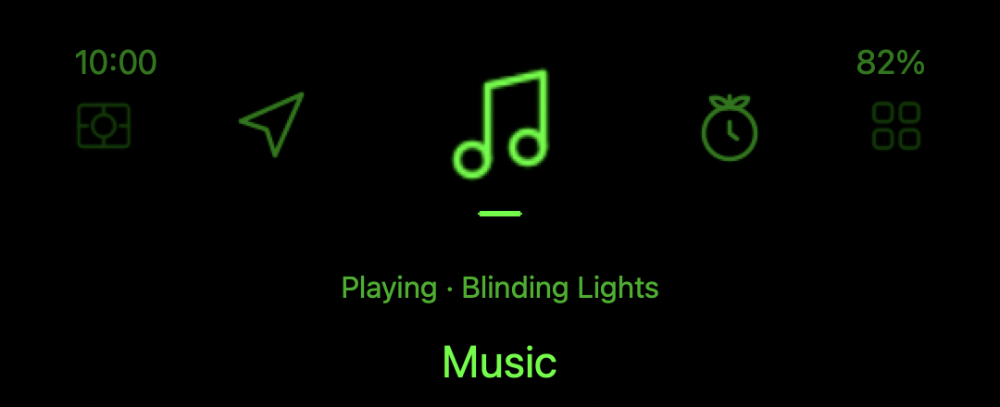 | 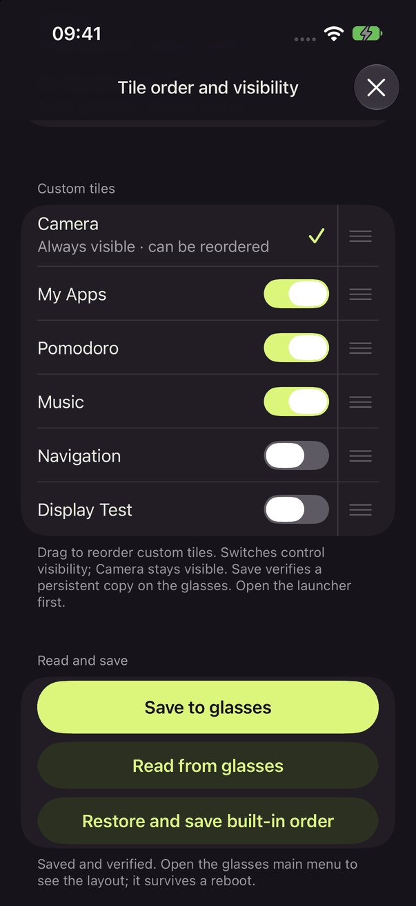 |
| **导航。** Apple 地图逐向导航，显示下一个转弯、距离和一张小路线图。 | 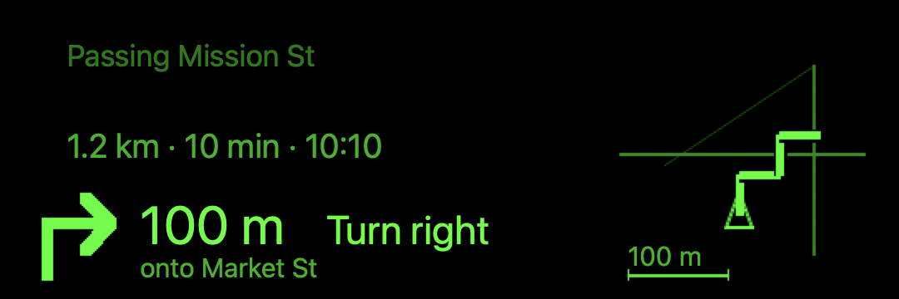 | 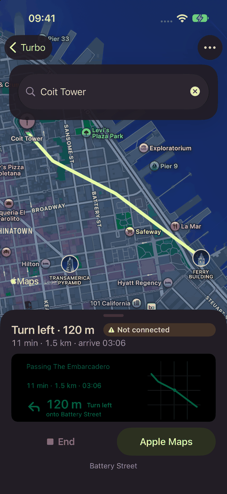 |
| **音乐与歌词。** Spotify 当前曲目和同步歌词；当前句在最下面，也最亮。 | 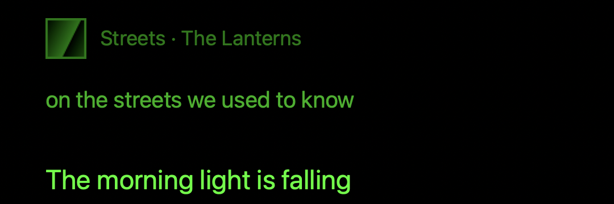 | 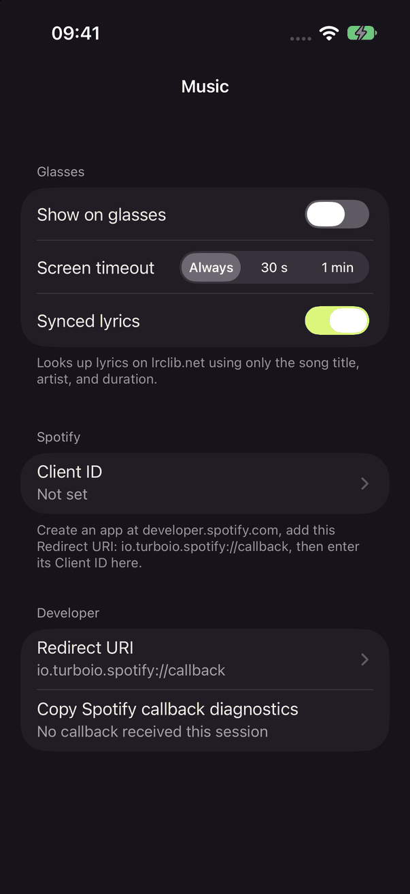 |
| **专注计时。** 在眼镜上运行的番茄钟。 | 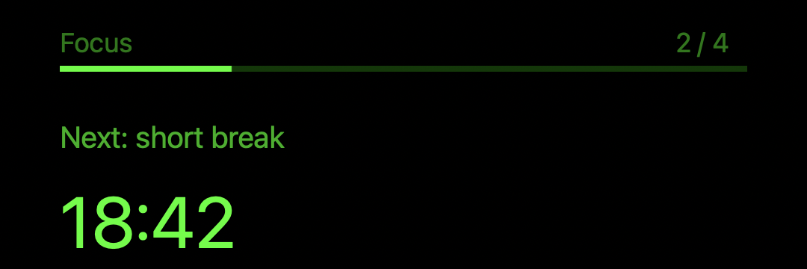 | 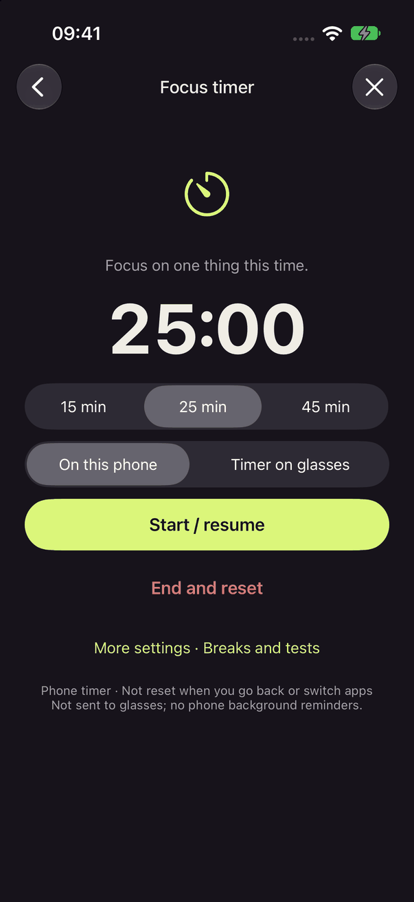 |
| **仪表盘。** 一张你自己排版的卡片，数据来自你自己的数据源。 | 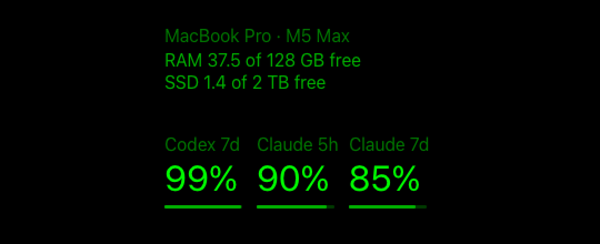 | 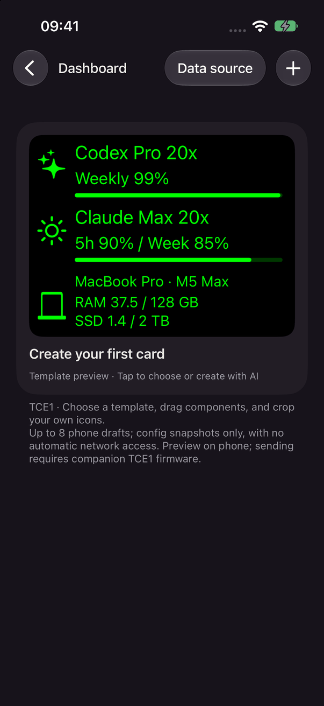 |
| **小应用。** 用应用 SDK 做的小页面；旋钮移动焦点，按下即选择。 | 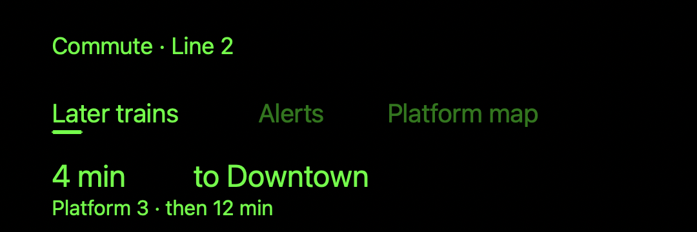 | |
| **眼镜锁。** 用旋钮输入 4 位 PIN。眼镜折叠或闲置后会上锁。 | 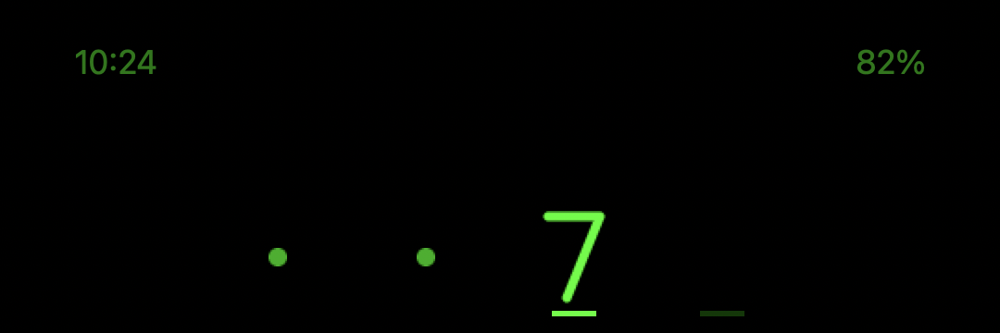 | 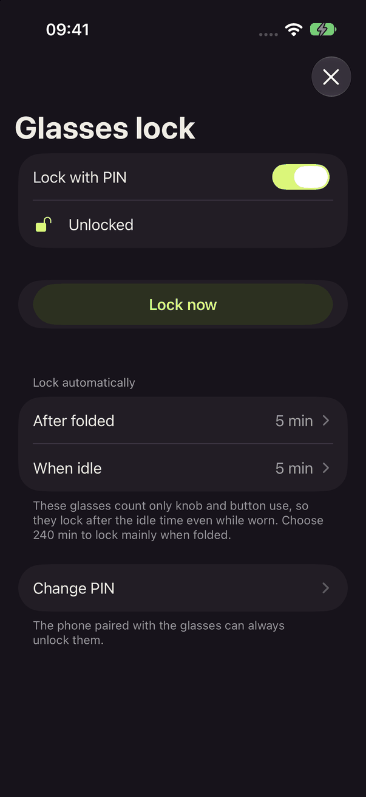 |
| **助手与字幕。** 用你自己的 AI 模型驱动眼镜助手，以及带翻译的实时字幕。 | | 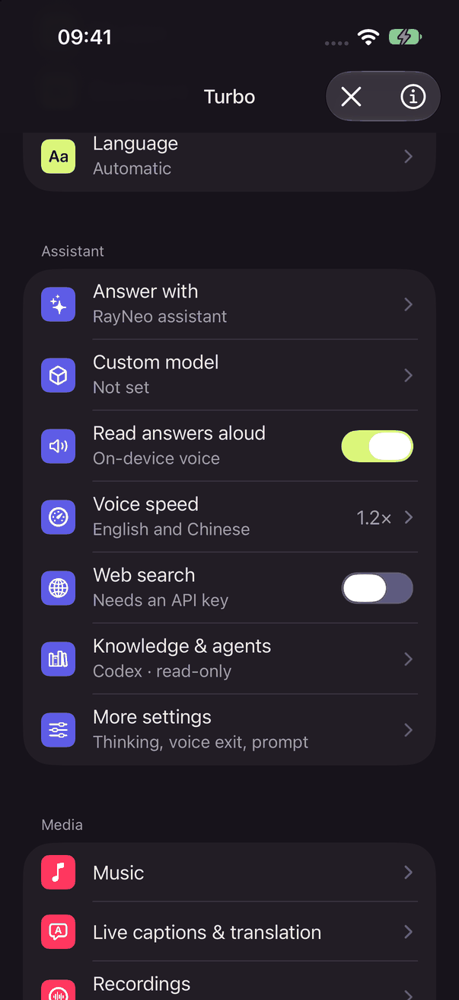 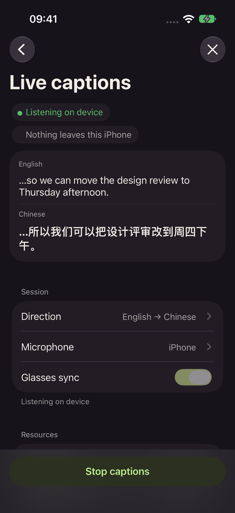 |

所有功能都从 RayNeo App 里的一个总入口页面进入：

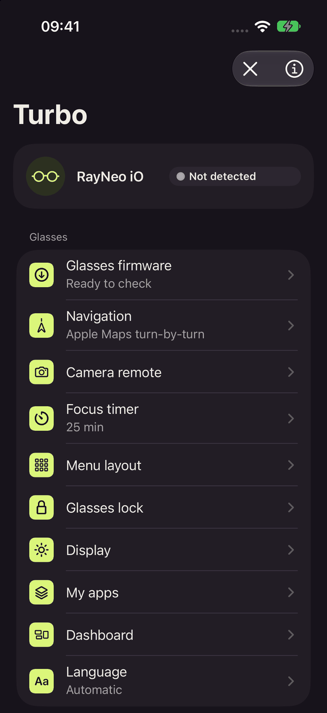

眼镜图片是在 Mac 上用固件自己的排版代码绘制的，字体用了替代字体，所以间距和位置是真实的，字形接近。手机图片是插件页面在模拟器里配合示例数据的截图（界面语言为英文）。两者都不是透过镜片拍的照片。

<a id="ios107-update"></a>

## 当前版本：C26 + TMG17

手机构建和固件必须成对使用。C26 带两个包，在它的刷写向导里二选一：TMG17，或用于回退的原厂 Strix OS 1.0.6.11。

| | |
|---|---|
| 手机构建 | C26：RayNeo AI 1.0.21 (1)，完整构建 |
| 固件 | TMG17：在 TMG15（TMG12 加眼镜 PIN 锁）基础上换了新的 PIN 界面并修复了勿扰模式问题，底座为原厂 Strix OS 1.0.6.11 |
| TMG17 ZIP SHA-256 | `dab9cdbde8b5a29eb0f481b062ed3f82af4b56941eac8438d212dee3ffabae01` |

发布于 2026-11-26（标签 `app/c26` 和 `fw/tmg17`）。所有哈希、做过哪些检查以及回退方法都在[发布记录](ios-addon/RELEASE.md)里。上一个版本 C24 + TMG15 就是回退路径。

眼镜锁随 TMG15 加入。眼镜折叠或闲置达到设定时间后会上锁。用旋钮输入 4 位 PIN 解锁，或从手机解锁。上锁期间屏幕全黑，什么都无法启动：按键、唤醒词、麦克风都不行。打开“佩戴时保持解锁”后，戴在头上的眼镜不会上锁。这个锁能挡住随手拿起眼镜的人，但不是为抵御蓄意破解而设计的。在 Turbo › 眼镜 › 眼镜锁 中设置。

TMG15 之后的新内容：按设计系统重绘的 PIN 界面，正在输入的数字放大显示（TMG16）；开着勿扰模式时 PIN 界面也会保持显示；输错次数提示在 30 秒后熄灭（TMG17）。TMG16 和 C25 从未打过标签。

刷写请按 [OTA.md](ios-addon/OTA.md) 操作。只刷其中列出的 ZIP，并且只在 SHA-256 一致时刷。

### 早期版本

每个版本都是一个附注 git 标签。运行 `git show <tag>` 可查看它的 ZIP SHA-256、构建提交和配对构建。ZIP 哈希也列在[发布记录](ios-addon/RELEASE.md#earlier-releases)里。

| 手机 | 固件 | RayNeo AI 宿主 | 原厂 Strix OS | 标签 |
|---|---|---|---|---|
| C24 | TMG15 | 1.0.21 (1) | 1.0.6.11 | `app/c24`, `fw/tmg15` |
| C20, C21 | TMG12 | 1.0.21 (1) | 1.0.6.11 | `app/c20`, `app/c21`, `fw/tmg12` |
| C18 | TMG11 | 1.0.11 (259) | 1.0.5.12 | `app/c18`, `fw/tmg11` |
| C16 | TMG10 | 1.0.11 (259) | 1.0.5.12 | `app/c16`, `fw/tmg10` |
| C13 | TMG9 | 1.0.7 (230) | 1.0.5.5 | `app/c13`, `fw/tmg9` |
| C12 | TMG8 | 1.0.7 (230) | 1.0.5.5 | `app/c12`, `fw/tmg8` |
| C11 | TMG7 | 1.0.7 (230) | 1.0.5.5 | `app/c11`, `fw/tmg7` |

更早的固件在标签 `fw/tmg2` 到 `fw/tmg6` 里。截至 2026-10-23 的带日期记录在[更新日志](docs/CHANGELOG.md)里。

## 刷写之前

- 刷写可能让眼镜无法使用，且不保证能恢复。刷写风险由你自己承担。
- 保持 RayNeo 的自动更新和 AI 更新关闭。
- 每个新构建都要覆盖安装在现有的 RayNeo App 上。绝不要删除它：删除会清掉配对和刷写门禁的状态。
- 绝不要混用不同版本的手机构建和固件。
- 绝不要为了绕过拒绝而修改版本、哈希或授权检查。

<a id="ios-原厂砸壳-ipa-下载"></a>

## 构建

你需要自己的 RayNeo AI 1.0.21 (1) 解密副本、自己的签名配置，以及一个放在仓库外的 `package.env` 文件。脚本通过 `$TURBO_INPUTS` 找到这个文件。下面的命令都不会碰设备。

1. 运行快速检查：`bash scripts/turbo-gate.sh --only-build`
2. 运行完整检查：`bash scripts/turbo-gate.sh`
3. 构建并签名 C26：`bash scripts/turbo-package.sh --host 1021-full --wire-log <label>`
4. 自己把 IPA 覆盖安装到现有 App 上，然后按 [OTA.md](ios-addon/OTA.md) 刷写。

本项目公开过的原厂 App 输入（1.0.7 及更早）列在 [official-apps](official-apps/README.md) 里。它们不含任何 Turbo IO 代码。

<a id="让-claude-code--codex-帮你接入"></a>

## 用编程助手

你可以把本仓库交给 Claude Code 或 Codex，让它运行检查和构建。请先读 [docs/AI_SETUP.md](docs/AI_SETUP.md)。编程代理必须遵守 [AGENTS.md](AGENTS.md)。

复制这段提示词：

```text
请帮我用这个仓库构建 Turbo IO，仅供个人非商业使用。
先阅读 README.md、AGENTS.md 和 docs/AI_SETUP.md。
检查我的工具和未提交的改动。不要覆盖或重置任何东西。
使用仓库自带的脚本：先运行 scripts/turbo-gate.sh，再用 scripts/turbo-package.sh --host 1021-full --wire-log 构建 C26。
如果某个输入与固定的版本或哈希不符，请停下来告诉我缺了什么。绝不要为了通过而修改检查。
不要安装 App、不要刷写眼镜、不要删除任何 App。这些由我自己做。
密钥和签名密码由我自己输入。绝不要在聊天里索要，也绝不要提交它们。
最后报告哪些通过、哪些失败、哪些没有运行。构建通过不代表它在眼镜上能用。
```

## 接下来读什么

- [OTA.md](ios-addon/OTA.md)：刷写当前这一对，以及门禁拒绝时怎么办。
- [RELEASE.md](ios-addon/RELEASE.md)：发布记录，包含所有哈希、设备状态和回退路径。
- [firmware/README.md](firmware/README.md)：固件源码树、眼镜锁的行为，以及构建方法。
- [插件 README](ios-addon/README.md)：手机插件、它的构建和测试组。
- [docs/README.md](docs/README.md)：其他所有文档的索引，包括开发者 SDK 和设计系统。

## 仓库结构

| 路径 | 内容 |
|---|---|
| `ios-addon/` | iOS 插件：构建、打包、测试和刷写指南 |
| `firmware/` | 修改版眼镜固件，一棵源码树；版本标签在 `firmware/RELEASE` |
| `firmware-research/` | 固件测试和旧版本重建用到的原厂 Strix OS 1.0.5.5 与 1.0.5.12 ZIP，以及较早的研究笔记 |
| `official-apps/` | 已公开的原厂 App 输入的索引和校验和 |
| `dashboard-service/`, `app-gallery/`, `skills/` | 仪表盘与小应用 SDK、20 个应用模板，以及一个代理技能 |
| `rayneo-protocol/`, `rayneo-display/`, `rayneo-audio-container/`, `rayneo-transport-ios/` | 已移除的 V1 客户端留下的 Swift 包，作为净室参考保留 |
| `scripts/` | 检查门禁、打包和源码审计 |
| `tools/` | 离线分析工具 |
| `docs/` | 用户和开发者文档 |

<a id="隐私与许可"></a>

## 隐私与许可

你的密钥保存在你自己 iPhone 的钥匙串里。云端对话会把音频或识别出的文字上传到你配置的服务。发布内容不含个人录音、聊天、凭据、日志或签名密钥。见 [docs/SOURCE_RELEASE.md](docs/SOURCE_RELEASE.md)。

原创代码采用 [PolyForm Noncommercial License 1.0.0](LICENSE)。商业使用或付费分发需要许可。此前的 MIT 授权不会撤回；见 [docs/LICENSING.md](docs/LICENSING.md)。第三方组件保留各自的许可；见 [THIRD_PARTY_NOTICES.md](THIRD_PARTY_NOTICES.md)。RayNeo 自己的 App 和固件仍归 RayNeo 所有。

本项目与 RayNeo 无关联。
