# Turbo IO

An unofficial SDK and set of patched builds for RayNeo iO glasses. It has two parts:

- **Phone addon.** Objective-C and C code that runs inside the RayNeo AI iPhone app. It adds Spotify music and lyrics, Apple Maps navigation, a Pomodoro timer, your own AI model, dashboards and mini-apps.
- **Glasses firmware.** Patched Strix OS builds for the glasses, built from one source tree. The current one adds a PIN lock.

It is for developers. It is not a finished product. If you just want to use the glasses, keep the official app and firmware.

There are no prebuilt or signed apps here. You merge, sign and install the addon yourself.

## What it looks like

The glasses show green on a see-through lens; black here is transparent there. Each feature has a page on the glasses and a page on the phone that sets it up.

| Feature | On the glasses | On the phone |
|---|---|---|
| **Menu.** A carousel of the stock tiles and the Turbo ones. You choose the order and what is hidden. | 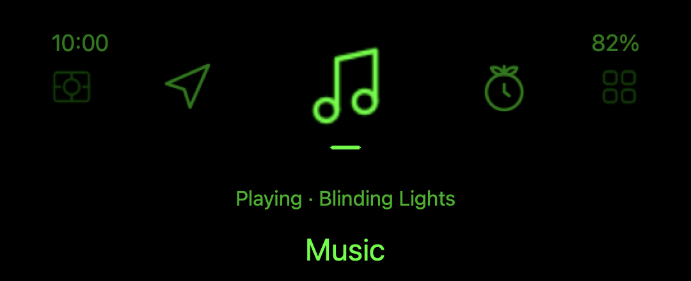 | 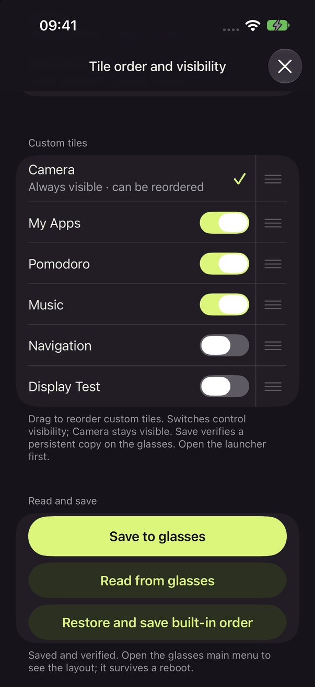 |
| **Navigation.** Apple Maps turn-by-turn, with the next turn, the distance and a small route sketch. | 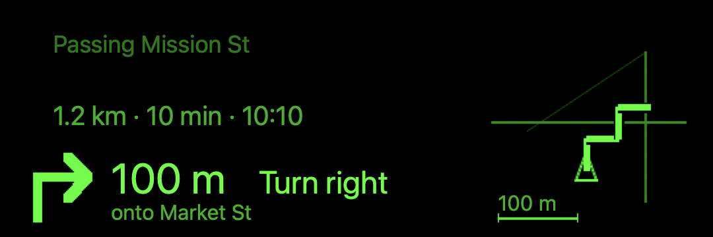 | 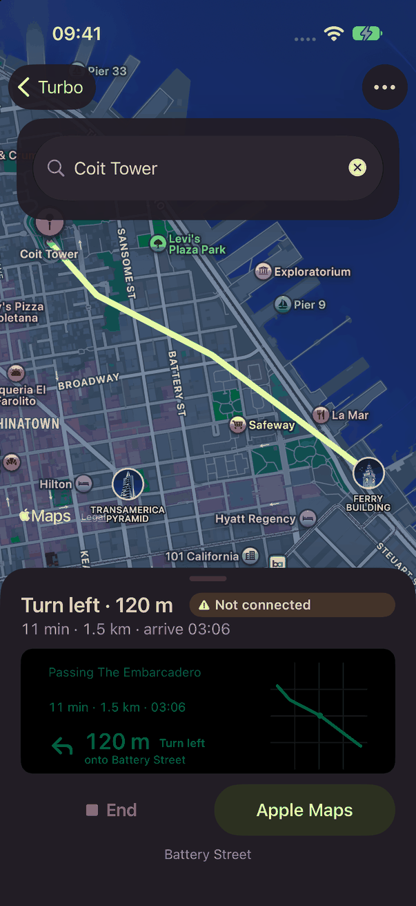 |
| **Music and lyrics.** The track from Spotify with synced lyrics; the current line is lowest and brightest. | 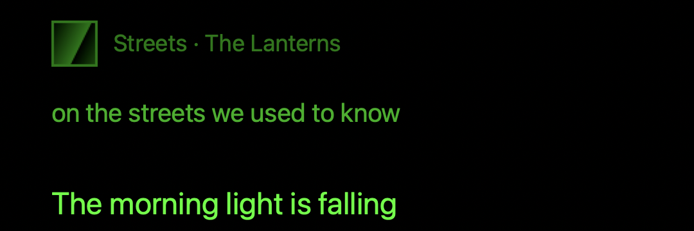 | 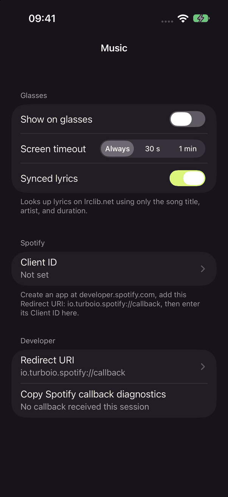 |
| **Focus timer.** A Pomodoro timer that runs on the glasses. | 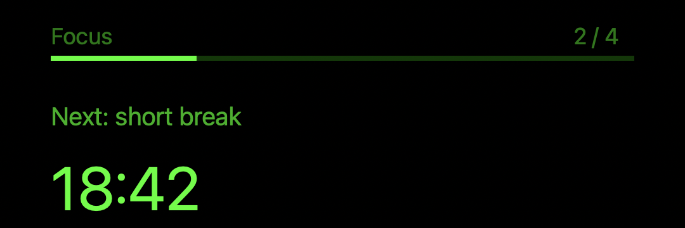 | 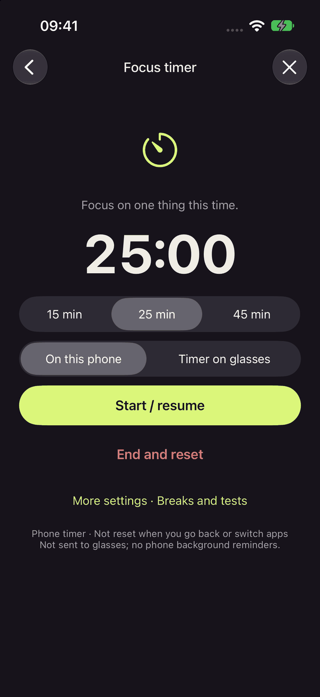 |
| **Dashboard.** A card you lay out yourself, filled from your own data source. | 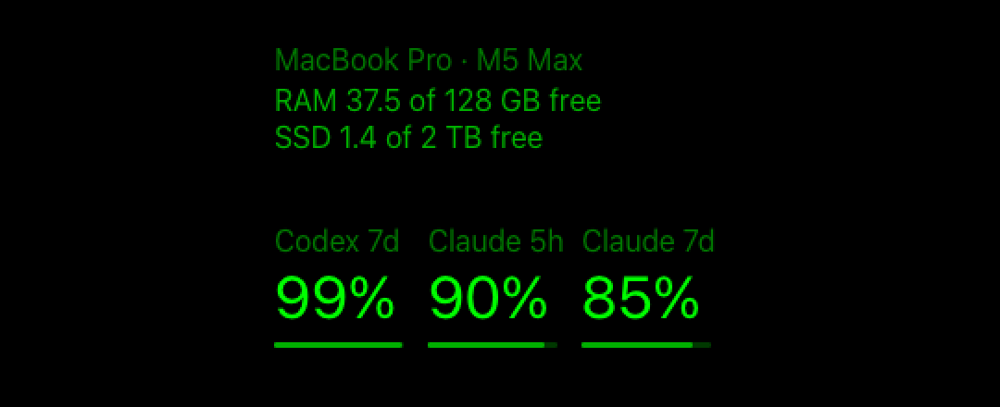 | 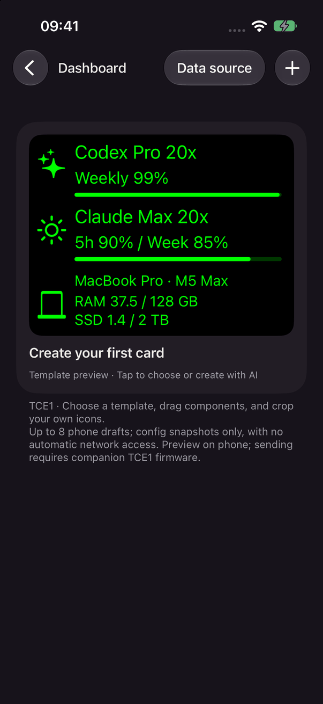 |
| **Mini-apps.** Small pages built with the app SDK; the knob moves the focus and a press selects. | 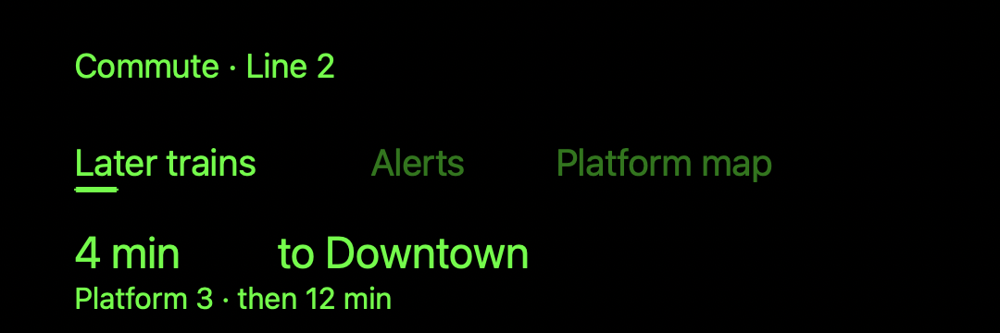 | |
| **Glasses lock.** A 4-digit PIN entered with the knob. The glasses lock when folded or left idle. | 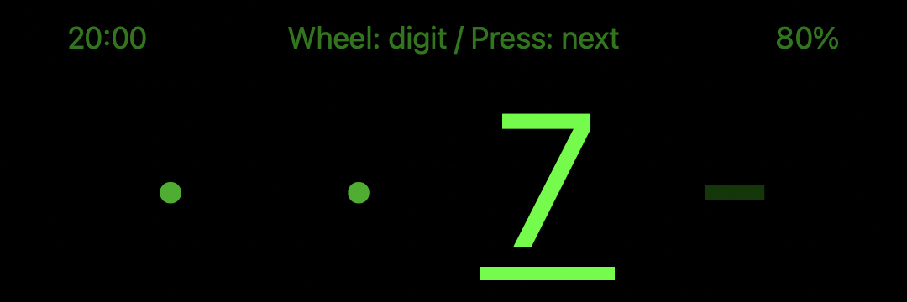 | 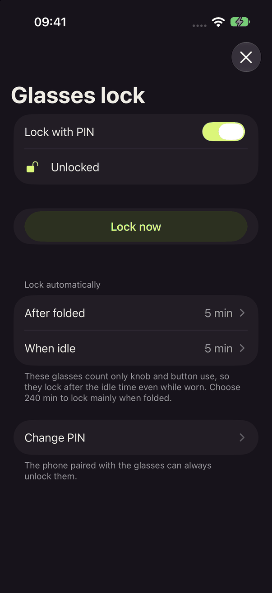 |
| **Assistant and captions.** Your own AI model behind the glasses assistant, and live captions with translation. | | 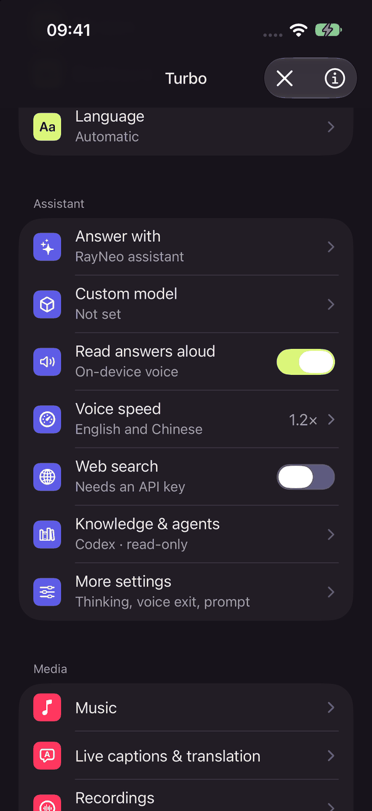 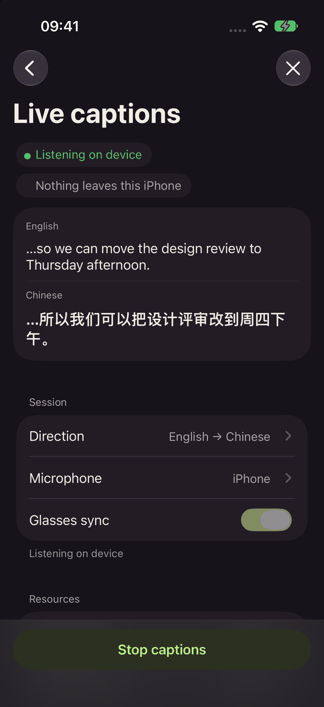 |

All of it is reached from one hub page in the RayNeo app:

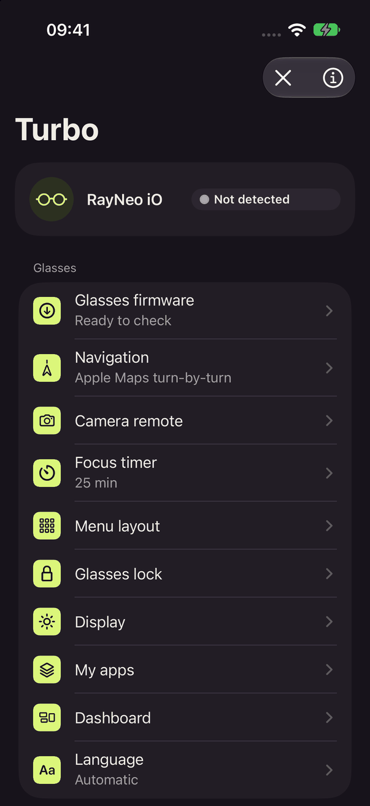

The glasses pictures are drawn on a Mac by the firmware's own layout code, with a substitute font, so spacing and positions are the real ones and the letter shapes are close. The phone pictures are simulator screenshots of the addon's pages with sample data. Neither is a photo through the lens.

<a id="ios107-update"></a>

## Current release: C24 + TMG15

Always use the phone build and the firmware as a pair. C24 carries two packages, and you pick one in its flash wizard: TMG15, or stock Strix OS 1.0.6.11 to go back.

| | |
|---|---|
| Phone build | C24: RayNeo AI 1.0.21 (1), full build |
| Firmware | TMG15: TMG12 plus a PIN lock for the glasses, on stock Strix OS 1.0.6.11 |
| TMG15 ZIP | `StrixOS-1.0.6.11-TurboIO-TMG15-CANDIDATE-NOT-APPROVED.zip`, 9,559,509 bytes |
| TMG15 ZIP SHA-256 | `206d19f1bfb4b97f37826ed18c288c975e17ca83a066ad7d00a275c1be697d49` |
| Stock ZIP SHA-256 | `5821506f720a43a9a3aea9c5722a1548463dcf1cbedcb2d97a242e2a64037d6e` (9,447,267 bytes) |
| Glasses must report | Strix OS 1.0.5.12 or 1.0.6.11 |
| Build identity after a TMG15 flash | `429943006439d62a611dc7b1af758c2912e7d5190bc1ed5ba2e0372c748f6d26` |

New in this release is the glasses lock. The glasses lock after they have been folded or left idle for a set time. You unlock them with a 4-digit PIN on the knob, or from the phone. While locked, the display is dark and nothing can be started: no key, no wake word, no microphone. With "Stay unlocked while worn" on, glasses on your head do not lock. The lock keeps a casual hand off your glasses; it is not built to resist a determined one. Set it up in Turbo › Glasses › Glasses lock.

TMG15 was flashed from C24 on 2026-11-23 and passed the owner's device check (tags `app/c24` and `fw/tmg15`). It changes two firmware files, the launcher image and the Bluetooth core's image. The pins are the `c24` entry in [releases.json](ios-addon/releases.json).

To flash, follow [OTA.md](ios-addon/OTA.md). Flash only these ZIPs, and only if the SHA-256 matches the line above.

### Earlier releases

Each release is an annotated git tag. Run `git show <tag>` to see its ZIP SHA-256, build commit and paired build.

| Phone | Firmware | RayNeo AI host | Stock Strix OS | Tags |
|---|---|---|---|---|
| C20, C21 | TMG12 | 1.0.21 (1) | 1.0.6.11 | `app/c20`, `app/c21`, `fw/tmg12` |
| C18 | TMG11 | 1.0.11 (259) | 1.0.5.12 | `app/c18`, `fw/tmg11` |
| C16 | TMG10 | 1.0.11 (259) | 1.0.5.12 | `app/c16`, `fw/tmg10` |
| C13 | TMG9 | 1.0.7 (230) | 1.0.5.5 | `app/c13`, `fw/tmg9` |
| C12 | TMG8 | 1.0.7 (230) | 1.0.5.5 | `app/c12`, `fw/tmg8` |
| C11 | TMG7 | 1.0.7 (230) | 1.0.5.5 | `app/c11`, `fw/tmg7` |

Older firmware is in the tags `fw/tmg2` to `fw/tmg6`. Dated notes up to 2026-10-23 are in the [changelog](docs/CHANGELOG.md).

## Before you flash

- Flashing can leave the glasses unusable. Recovery is not guaranteed. You flash at your own risk.
- Keep RayNeo Auto Update and AI updates off.
- Install every new build over the existing RayNeo app. Never delete it: that wipes the pairing and the flash gate's state.
- Never mix phone builds and firmware from different releases.
- Never change a version, hash or authorization check to get past a refusal.

<a id="ios-原厂砸壳-ipa-下载"></a>

## Build

You need your own decrypted copy of RayNeo AI 1.0.21 (1), your own signing setup, and a `package.env` file outside the repo. The scripts find that file through `$TURBO_INPUTS`. None of these commands touches a device.

1. Run the quick check: `bash scripts/turbo-gate.sh --only-build`
2. Run the full check: `bash scripts/turbo-gate.sh`
3. Build and sign C24: `bash scripts/turbo-package.sh --host 1021-full --wire-log <label>`
4. Install the IPA over the existing app yourself. Then flash with [OTA.md](ios-addon/OTA.md).

The stock app inputs this project has published (1.0.7 and older) are listed in [official-apps](official-apps/README.md). They contain no Turbo IO code.

<a id="让-claude-code--codex-帮你接入"></a>

## Use a coding assistant

You can hand this repo to Claude Code or Codex and let it run the checks and the build. Read [docs/AI_SETUP.md](docs/AI_SETUP.md) first. Coding agents must follow [AGENTS.md](AGENTS.md).

Copy this prompt:

```text
Help me build Turbo IO from this repository, for personal non-commercial use.
Read README.md, AGENTS.md and docs/AI_SETUP.md first.
Check my tools and any uncommitted changes. Do not overwrite or reset anything.
Use the repo's own scripts: run scripts/turbo-gate.sh, then build C24 with scripts/turbo-package.sh --host 1021-full --wire-log.
If an input does not match its pinned version or hash, stop and tell me what is missing. Never change a check to get past it.
Do not install the app, flash the glasses or delete any app. I do those myself.
I enter keys and signing passwords myself. Never ask for them in chat, and never commit them.
At the end, report what passed, what failed and what was not run. A passing build does not mean it works on the glasses.
```

## Where to go next

- [OTA.md](ios-addon/OTA.md): flash the current pair, and what to do if the gate refuses.
- [firmware/README.md](firmware/README.md): the firmware tree, its build and the record of each release.
- [Addon README](ios-addon/README.md): the phone addon, its build and its test groups.
- [docs/README.md](docs/README.md): the index of all other docs, including the developer SDK and the design system.

## Repository layout

| Path | Contents |
|---|---|
| `ios-addon/` | The iOS addon: build, packaging, tests and the flash guide |
| `firmware/` | The patched glasses firmware, one tree; the release label is in `firmware/RELEASE` |
| `firmware-research/` | Stock Strix OS 1.0.5.5 and 1.0.5.12 ZIPs used by the firmware tests and by rebuilds of earlier releases, and older research notes |
| `official-apps/` | Index and checksums of the published stock app inputs |
| `dashboard-service/`, `app-gallery/`, `skills/` | The dashboard and mini-app SDK, 20 app templates, and an agent skill |
| `rayneo-protocol/`, `rayneo-display/`, `rayneo-audio-container/`, `rayneo-transport-ios/` | Swift packages from the removed V1 client, kept as clean-room reference |
| `scripts/` | The check gate, packaging and the source audit |
| `tools/` | Offline analysis tools |
| `docs/` | User and developer docs |

<a id="隐私与许可"></a>

## Privacy and license

Your keys stay in your own iPhone keychain. Cloud chat uploads audio or recognized text to the service you configure. Releases contain no personal recordings, chats, credentials, logs or signing keys. See [docs/SOURCE_RELEASE.md](docs/SOURCE_RELEASE.md).

Original code is under the [PolyForm Noncommercial License 1.0.0](LICENSE). Commercial use or paid distribution needs permission. Earlier MIT grants are not revoked; see [docs/LICENSING.md](docs/LICENSING.md). Third-party components keep their own licenses; see [THIRD_PARTY_NOTICES.md](THIRD_PARTY_NOTICES.md). RayNeo's own app and firmware stay RayNeo's.

This project is not affiliated with RayNeo.
